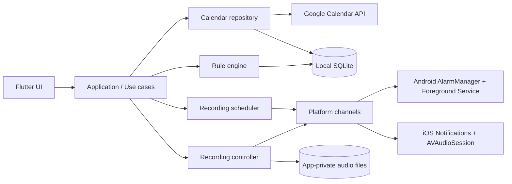

# Auto Meeting(가칭) 제품 기획서

- 문서 버전: 0.2
- 작성일: 2026-09-13
- 개발 프레임워크: Flutter
- 대상 플랫폼: Android 우선, iOS 지원
- 문서 상태: MVP 제안안
- 제품명 메모: 회의 전용이 아니므로 출시 명칭은 재검토

> 검토 상태: v0.2는 구현 확정 사양이 아니다. 녹음 대기 모드, 다중 계정 인증 유지, 동기화 기간 갱신, 계정 해제 시 예약 처리, 겹친 일정 처리, OS 백업 정책을 보완해야 한다. 아래의 대기 모드·시나리오·완료 기준은 기술 검증 전 가정이며 지원을 보장하지 않는다. 수정 순서와 통과 기준은 [개발 진행 계획](IMPLEMENTATION_PLAN.md)을 따른다.

## 1. 제품 한 줄 정의

여러 Google 계정의 선택한 캘린더에 등록된 일정을 자동으로 모아, 일정 시작 시점에 녹음을 놓치지 않도록 알리고 안전하게 녹음·보관하는 모바일 앱.

## 2. 배경과 해결할 문제

회의, 인터뷰, 강의, 상담, 개인 메모 등 녹음이 필요한 시간은 캘린더에 이미 등록되어 있지만 사용자가 매번 별도의 녹음 앱을 찾아 실행해야 한다. 이 과정에서 녹음을 늦게 시작하거나 아예 잊는 일이 생긴다.

Auto Meeting은 다음 과정을 자동화한다.

1. 하나 이상의 Google 계정을 읽기 전용으로 연결한다.
2. 각 계정에서 녹음 대상으로 사용할 캘린더를 선택한다.
3. 선택한 캘린더의 시간형 일정을 기본 녹음 후보로 만든다.
4. OS가 허용하는 상태에서는 시작 시간에 자동 녹음하고, 그렇지 않으면 알림의 한 번 탭으로 즉시 시작한다.
5. 일정 종료 시간에 녹음을 끝내고 일정 및 원본 계정 정보와 함께 기기에 저장한다.

## 3. 핵심 전제와 플랫폼 제약

### 3.1 반드시 구분할 두 가지 의미

- 이 앱은 휴대폰 **마이크로 주변 음성**을 녹음한다.
- Google Meet, Zoom, 전화 등 다른 앱의 **내부 통화 오디오를 직접 추출**하는 기능은 MVP 범위가 아니다.

동일 휴대폰에서 통화·화상회의 중일 때는 다른 앱이 오디오 세션을 점유하여 녹음이 실패하거나 상대방 음성이 담기지 않을 수 있다. 실제 사용 권장 환경은 대면 회의 또는 회의 음성이 스피커로 재생되는 환경이다.

### 3.2 완전 무인 자동 녹음의 제약

최신 Android에서는 `RECORD_AUDIO`가 while-in-use 권한이므로, 앱이 백그라운드에 있을 때 마이크 유형 Foreground Service를 새로 시작할 수 없는 경우가 있다. Android 14 이상에서는 서비스 유형과 전용 권한도 명시해야 한다. Exact Alarm은 정각 작업 예약에는 도움이 되지만 백그라운드 마이크 접근을 모든 상황에서 보장하지 않는다.

iOS는 실행 중인 녹음을 화면 잠금 후에도 계속할 수 있지만, 임의의 미래 시각에 앱을 정확히 깨워 새 녹음을 시작하는 것은 보장하지 않는다. 백그라운드 작업 실행 시각은 시스템이 결정한다.

따라서 제품 모드는 아래와 같이 정의한다.

| 모드 | 동작 | 플랫폼 | MVP |
|---|---|---|---|
| 알림 시작 모드 | 시작 시각에 알림을 표시하고 사용자가 `녹음 시작`을 탭 | Android/iOS | 기본값 |
| 녹음 대기 모드 | 일정 전 사용자가 한 번 대기 상태를 활성화하면 앱/오디오 세션을 유지하고 정각에 자동 시작 | Android 우선, iOS는 기기 테스트 후 지원 범위 확정 | 포함 |
| 앱 활성 자동 모드 | 앱이 화면에 열려 있으면 정각에 자동 시작 | Android/iOS | 포함 |
| 완전 무인 모드 | 앱이 종료된 상태에서도 사용자 개입 없이 정각에 마이크를 켬 | 신뢰성 및 심사 위험이 큼 | 제외 |

제품 메시지는 “항상 완전 자동”이 아니라 **“여러 캘린더 일정을 자동 감지하고, 가능한 상태에서는 자동으로 녹음하며, 나머지는 한 번의 탭으로 시작”**으로 표현한다.

## 4. 목표와 비목표

### 목표

- 업무용·개인용 등 여러 Google 계정의 일정을 한곳에서 추적한다.
- 선택한 캘린더에 등록된 시간형 일정을 자동으로 녹음 후보로 식별한다.
- 사용자가 녹음해야 할 일정을 놓치지 않게 한다.
- 최소 조작으로 일정 시작부터 종료까지 녹음한다.
- 캘린더 일정과 녹음 파일을 자동 연결한다.
- 음성 파일과 인증 정보를 안전하게 기기에 보관한다.

### 비목표(MVP)

- 통화·Google Meet·Zoom의 시스템 내부 음성 캡처
- 실시간 음성 인식, 요약, 화자 분리
- 녹음 파일의 서버 자동 업로드 및 다중 기기 동기화
- Google Calendar 일정 생성·수정
- Microsoft Outlook/Apple Calendar 연동
- 조직 관리자용 중앙 통제 및 감사 기능

## 5. 대상 사용자와 대표 시나리오

### 핵심 사용자

- 업무용과 개인용 Google 계정을 함께 관리하는 사용자
- 회의·인터뷰·강의·상담·연구 세션을 캘린더 기반으로 관리하는 사용자
- 캘린더에 녹음할 시간을 직접 일정으로 등록해 사용하는 사용자
- 수동 녹음 시작을 자주 잊는 사용자

### 대표 시나리오

1. 사용자가 업무용 Google 계정과 개인용 Google 계정을 연결한다.
2. 각 계정에서 추적할 캘린더를 선택한다.
3. 사용자가 Google Calendar에 14:00~15:00 `현장 인터뷰 녹음` 일정을 직접 등록한다.
4. 앱이 여러 계정의 향후 일정을 동기화하고 해당 시간형 일정을 녹음 후보로 발견한다.
5. 13:50에 “10분 뒤 녹음 예정” 알림을 보낸다.
6. 사용자가 알림에서 `녹음 대기`를 누른다.
7. 14:00에 녹음이 시작되고 지속 알림/상태 표시가 나타난다.
8. 15:00에 자동 종료되어 `2026-09-13_현장-인터뷰-녹음.m4a`로 저장된다.
9. 사용자는 앱에서 재생, 이름 변경, 공유 또는 삭제할 수 있다.

## 6. 계정·캘린더·이벤트 선별 규칙

### 6.1 다중 계정 규칙

- 사용자는 Google 계정을 여러 개 연결할 수 있다.
- 계정마다 OAuth 인증 정보, 동기화 토큰, 캘린더 선택 상태를 독립 관리한다.
- 홈과 예정 일정 화면에서 전체 계정을 합쳐 보거나 특정 계정만 필터링할 수 있다.
- 계정 연결 해제 시 해당 계정의 인증 정보와 일정 캐시만 제거하며 다른 계정에는 영향을 주지 않는다.
- 같은 일정이 여러 연결 계정에 초대로 들어온 경우 `iCalUID + 원래 시작 시각`을 기준으로 하나의 녹음 계획으로 합친다.

### 6.2 기본 이벤트 규칙

- 검사 대상: 연결된 모든 계정에서 사용자가 선택한 Google Calendar들
- 기본 녹음 후보: 시작·종료 시각이 있는 모든 일반 일정
- 일정에 참석자가 없거나 이메일이 포함되지 않은 개인 일정도 후보에 포함
- 사용자가 Google Calendar 앱 또는 웹에서 직접 만든 일정도 다음 동기화 후 동일하게 처리
- 기본 제외:
  - 종일 일정
  - 취소된 일정
  - 사용자가 참석을 거절한 일정
  - 종료 시각이 없는 일정
  - 생일, 부재중, 근무 위치 등 녹음 목적이 아닌 특수 이벤트 유형

Google Calendar의 자유 검색 `q`에 의존하지 않고 각 계정의 이벤트 데이터를 동기화한 뒤 앱에서 녹음 후보와 예외를 명시적으로 판정한다.

### 6.3 사용자 설정과 선택 규칙

- Google 계정 추가/연결 해제/재인증
- 계정별 표시 이름과 구분 색상
- 계정별 캘린더 포함/제외
- 캘린더별 기본 정책: 모든 시간형 일정(기본) / 내가 만든 일정만 / 수동 선택만
- 일정별 이번 한 번 녹음 제외 또는 강제 포함
- 선택 필터: 제목 키워드, 참석자/주최자 이메일
- 이메일 필터는 여러 개 등록할 수 있고, 앞뒤 공백 제거 후 대소문자를 구분하지 않는 완전 일치로 비교
- 녹음 시작 오프셋: 정각(기본), 1분 전, 5분 전
- 녹음 종료 오프셋: 정각(기본), 5분 후, 10분 후
- 사전 알림 시점: 5분, 10분(기본), 15분

### 6.4 예외 처리

- 반복 일정은 개별 인스턴스로 펼쳐 예약한다.
- 일정 시간 또는 참석자가 바뀌면 기존 예약을 취소하고 다시 등록한다.
- 일정이 삭제·취소되면 녹음 예약도 취소한다.
- 진행 중 일정이 연장되어도 로컬 캘린더 동기화가 늦으면 원래 종료 시각에 종료될 수 있으므로, 녹음 화면에 `30분 연장` 버튼을 제공한다.
- 대상 일정이 겹치면 녹음기를 중복 실행하지 않고 하나의 녹음을 유지하며, 종료 시각은 대상 일정 중 가장 늦은 종료 시각으로 갱신한다.
- 시작 시각을 이미 지난 일정은 자동 시작하지 않고 “현재 일정을 지금 녹음” 알림/버튼만 제공한다.
- 시간대 변경 시 모든 미래 예약을 다시 계산한다.

## 7. 사용자 경험

### 7.1 온보딩

1. 앱 목적과 플랫폼 제약 안내
2. 녹음 중 항상 표시가 노출된다는 점 안내
3. 첫 Google 계정 로그인 및 캘린더 읽기 권한 동의
4. 추가 Google 계정 연결(선택, 온보딩 이후에도 가능)
5. 계정별 추적 캘린더 선택
6. 기본 녹음 정책 선택: 모든 시간형 일정 / 내가 만든 일정만 / 수동 선택만
7. 마이크 권한 요청
8. 알림 권한 요청
9. Android에서 필요한 경우 정확한 알람 권한 안내
10. 테스트 알림 및 테스트 녹음

권한은 첫 화면에서 한꺼번에 요청하지 않고, 기능 설명 직후 단계별로 요청한다.

### 7.2 주요 화면

| 화면 | 주요 내용 |
|---|---|
| 오늘 | 전체/계정별 필터, 다음 녹음 일정, 준비 상태, 즉시 녹음, 오늘의 일정 |
| 계정·캘린더 | 연결 계정 목록, 계정 추가, 계정별 캘린더와 기본 녹음 정책 |
| 녹음 규칙 | 기본 포함 방식, 제목·참석자 이메일 선택 필터, 예외 규칙 |
| 예정 일정 | 여러 계정에서 감지된 일정 목록, 원본 계정 배지, 일정별 녹음 제외/포함 |
| 녹음 중 | 경과 시간, 일정명, 일시정지, 종료, 연장, 입력 레벨 |
| 녹음 보관함 | 일정별 파일 목록, 재생, 이름 변경, 공유, 삭제 |
| 설정 | 알림 시각, 오프셋, 음질, 저장 공간, 권한 상태 |
| 진단 | 계정별 마지막 동기화, 다음 예약, 배터리 최적화 상태, 실패 사유 |

하단 탭은 `홈 / 예정 일정 / 녹음함 / 설정` 네 개로 유지한다. 홈과 예정 일정에는 `전체 / 업무 계정 / 개인 계정` 형태의 계정 필터 칩을 두고, 모든 일정 카드에 원본 계정과 캘린더 배지를 표시한다. 설정의 `계정 및 캘린더`에서 계정을 추가하거나 각 계정의 추적 범위를 바꾼다.

```text
┌─────────────────────────────┐
│ Auto Meeting        동기화 ✓ │
│ [전체] [업무] [개인]          │
│                             │
│ 다음 녹음                    │
│ ┌─────────────────────────┐ │
│ │ 현장 인터뷰 녹음          │ │
│ │ 오늘 14:00–15:00         │ │
│ │ 업무 계정 · 프로젝트 캘린더 │ │
│ │ [녹음 대기] [이번만 제외]  │ │
│ └─────────────────────────┘ │
│                             │
│ 개인 계정 · 17:30 강의 복습   │
└─────────────────────────────┘
```

계정 및 캘린더 화면은 계정 카드 단위로 구성한다. 각 카드에는 계정 이메일, 인증 상태, 마지막 동기화, 선택한 캘린더 수를 표시하고 `계정 추가` 버튼은 목록 하단에 고정한다.

### 7.3 알림 설계

- T-10분: `10분 뒤 [일정명] 녹음 예정` / 원본 계정 배지 / 액션: `녹음 대기`, `이번만 건너뛰기`
- T-0분: `일정이 시작되었습니다` / 액션: `녹음 시작`, `10분 후 다시 알림`
- 녹음 중: 지속 알림 / 액션: `일시정지`, `종료`
- 완료: `녹음이 저장되었습니다` / 액션: `재생`
- 실패: 구체적 원인 표시(마이크 권한, 다른 앱의 오디오 점유, 저장 공간, 예약 권한 등)

## 8. 기능 요구사항

### 필수(P0)

| ID | 요구사항 | 수용 기준 |
|---|---|---|
| FR-01 | Google 다중 계정 | 사용자가 Google 계정을 여러 개 연결·재인증·해제할 수 있고 계정별 인증 정보는 OS 보안 저장소에 분리 보관된다. |
| FR-02 | 다중 캘린더 읽기 | 연결 계정별로 캘린더를 선택하고 미래 이벤트를 가져와 앱 재실행 후에도 캐시한다. |
| FR-03 | 기본 일정 규칙 | 선택한 캘린더의 모든 시간형 일반 일정을 기본 녹음 후보로 판정하며 이메일이 없는 개인 일정도 포함한다. |
| FR-04 | 예약 생성 | 대상 이벤트마다 사전 알림과 시작 알림을 로컬에 예약한다. |
| FR-05 | 변경 반영 | 일정 변경·삭제 후 다음 동기화에서 예약이 중복 없이 갱신된다. |
| FR-06 | 녹음 시작 | 앱 활성 상태 또는 대기 상태에서는 시작 시각에 녹음한다. 그 외 상태에서는 한 번 탭으로 시작한다. |
| FR-07 | 녹음 종료 | 일정 종료 시각에 자동 종료하며 사용자가 수동 종료·연장할 수 있다. |
| FR-08 | 상태 표시 | 녹음 중임을 앱 UI와 OS 지속 알림/시스템 표시로 항상 알 수 있다. |
| FR-09 | 로컬 보관 | 파일, 일정명, 시작/종료, 길이, 상태를 저장하고 재생·삭제할 수 있다. |
| FR-10 | 복구 | 앱 강제 종료, 재부팅, 권한 해제 후 잘못된 예약을 정리하고 사용자에게 상태를 알린다. |
| FR-11 | 진단 | 계정별 마지막 동기화 시각, 다음 대상 일정, 다음 알림, 권한 및 실패 이유를 보여준다. |
| FR-12 | 중복 제거 | 같은 일정이 여러 연결 계정에 존재해도 하나의 녹음만 예약한다. |
| FR-13 | 계정 식별 UI | 일정과 녹음에 원본 Google 계정 및 캘린더를 명확히 표시한다. |

### 중요(P1)

- 녹음 파일 공유 및 이름 변경
- 일정별 일회성 제외/포함
- 제목 키워드 및 복수 참석자 이메일 선택 필터
- 녹음 음질 선택
- 저장 공간 부족 사전 경고
- 앱 잠금(생체 인증)
- 다크 모드 및 한국어/영어

### 후속(P2)

- 서버 기반 Calendar push notification과 기기 푸시
- 클라우드 백업
- 온디바이스 음성 인식 및 요약
- Outlook/Apple Calendar
- 팀 정책과 중앙 관리

## 9. 권한과 개인정보 보호

### 최소 권한 원칙

- Google Calendar: 읽기 전용 범위만 사용
- 마이크: 실제 녹음 기능 활성화 시 요청
- 알림: 일정 전 안내와 녹음 상태 표시 목적
- 정확한 알람(Android): 필요성과 설정 방법을 별도 화면에서 설명
- 저장소: 앱 전용 디렉터리를 기본 사용하고 공유 시에만 시스템 공유 화면 사용

### 개인정보 원칙

- 음성 파일은 기본적으로 서버에 전송하지 않는다.
- OAuth 토큰은 Android Keystore / iOS Keychain 기반 보안 저장소에 보관한다.
- 캘린더 캐시는 필요한 필드와 제한된 기간만 저장한다.
- 로그에 이메일 원문, 일정 설명, OAuth 토큰, 파일 경로를 남기지 않는다.
- 계정 연결 해제 시 해당 계정의 토큰과 캘린더 캐시만 삭제한다.
- 전체 데이터 삭제 기능을 제공한다.

### 녹음 고지

- 최초 설정 시 녹음 관련 동의와 책임을 명확히 고지한다.
- 녹음 중에는 눈에 띄는 화면 및 OS 표시를 유지한다.
- 비밀 녹음 기능, 아이콘 숨김, 무음 상태 표시 제거 기능은 제공하지 않는다.
- 회의 참가자에게 녹음 사실을 알리는 것은 사용자의 책임임을 안내하고, 실제 출시 전 대상 국가별 법률 검토를 진행한다.

## 10. 기술 설계

### 10.1 권장 구조



### 10.2 Flutter 영역

- UI, 상태 관리, 네비게이션
- Google 다중 계정 로그인 및 계정별 Calendar API 호출
- 계정별 일정 캐시, 기본 일정 규칙 및 선택 필터 엔진
- 녹음 예약 도메인 로직
- 녹음 목록, 재생, 삭제, 설정, 진단

권장 구성은 Riverpod 계열 상태 관리, `go_router`, SQLite/Drift 계열 로컬 DB, OS 보안 저장소이다. 패키지는 구현 착수 시 최신 유지 상태와 네이티브 백그라운드 지원 범위를 다시 검증해 확정한다.

### 10.3 네이티브 영역

Flutter 플러그인만으로 백그라운드 마이크와 정시 예약을 감싸면 OS 버전별 예외 대응이 어렵다. 핵심 녹음 수명주기는 Platform Channel을 통해 Kotlin/Swift로 구현한다.

Android:

- `AlarmManager`로 사용자에게 보이는 정확한 일정 작업 예약
- 마이크 유형 Foreground Service와 지속 알림
- `RECORD_AUDIO`, `POST_NOTIFICATIONS`, 관련 Foreground Service 권한 처리
- 재부팅, 시간/시간대 변경, 정확한 알람 권한 변경 시 재예약
- MediaRecorder 또는 AudioRecord 기반 AAC/M4A 저장

iOS:

- 사전·시작 로컬 알림
- `AVAudioSession`의 record/playAndRecord 구성
- 사용자가 시작한 녹음의 백그라운드 지속
- 오디오 interruption 및 route change 처리
- 앱이 활성 상태일 때의 정각 자동 시작

### 10.4 Calendar 동기화 전략

MVP는 별도 서버 없는 로컬 우선 구조로 시작한다.

- 계정 추가 시: 해당 계정에서 선택한 캘린더마다 현재부터 향후 30일의 이벤트 전체 동기화
- 이후: 계정·캘린더별 sync token을 사용해 앱 실행/복귀 시 incremental sync
- 백그라운드: OS가 허용할 때 주기 갱신
- 로컬 예약 창: 향후 7일
- 매일 예약 창을 연장
- 특정 캘린더의 sync token 만료로 HTTP 410이 오면 해당 캘린더 캐시만 안전하게 재구성하고 전체 동기화
- 한 계정의 인증 또는 동기화 실패가 다른 계정의 동기화를 막지 않도록 격리
- 네트워크가 없어도 이미 예약된 일정의 알림과 녹음은 동작

Google Calendar push notification은 HTTPS webhook 서버가 필요하고 알림이 100% 전달되는 것도 아니므로 MVP 이후 옵션으로 둔다. 도입 시에도 incremental sync를 최종 진실 공급원으로 유지한다.

### 10.5 파일 형식과 저장

- 기본 포맷: AAC-LC, `.m4a`
- 기본 품질 제안: mono, 44.1 kHz, 64~96 kbps
- 파일명: `yyyy-MM-dd_HHmm_정리된-일정명.m4a`
- 파일과 메타데이터 저장을 분리하고 내부 ID로 연결
- 저장 전 가용 공간 확인
- 중단/충돌 시 임시 파일 복구 또는 실패 표시
- 기본 보존 기간: 무제한, 사용자 직접 삭제

## 11. 데이터 모델 초안

| 엔터티 | 핵심 필드 |
|---|---|
| Account | id, googleAccountId, email, displayName, colorKey, credentialRef, connectedAt, authStatus |
| CalendarSource | id, accountId, googleCalendarId, name, selected, defaultPolicy, timeZone, syncTokenRef, lastSyncedAt |
| FilterRule | id, accountId?, calendarId?, type, valueNormalized, includeMode, enabled |
| CalendarEvent | id, accountId, calendarId, googleEventId, iCalUID, originalStartAt, title, creatorEmail, organizerEmail, attendees, startAt, endAt, status, updatedAt |
| RecordingPlan | id, dedupeKey, primaryEventId, scheduledStartAt, scheduledEndAt, mode, status, nativeScheduleId |
| RecordingPlanEventLink | planId, eventId |
| Recording | id, planId, sourceAccountId, fileUri, startedAt, endedAt, duration, size, status, failureCode |
| AppSettings | preAlertMinutes, startOffset, endOffset, quality, locale, retention |

OAuth refresh token과 민감한 비밀값은 일반 DB에 직접 저장하지 않고 보안 저장소의 참조만 보관한다.

## 12. 품질 요구사항

- 시간 정확성: OS가 허용하는 조건에서 예약 시각 기준 5초 이내 이벤트 처리
- 데이터 정합성: 동일 계정·캘린더·Google event instance에 로컬 이벤트는 하나만 존재
- 중복 방지: 여러 계정에 복제된 동일 일정은 하나의 활성 녹음 계획만 생성
- 내결함성: 중복 알람이 와도 녹음 파일을 중복 생성하지 않는 idempotent 처리
- 오프라인: 마지막 동기화된 7일 일정은 네트워크 없이 처리
- 접근성: 동적 글꼴, 스크린 리더 레이블, 색상 외 상태 표현
- 배터리: 상시 폴링 금지, 대기 모드는 종료 시각 또는 사용자 취소 시 즉시 해제
- 관찰성: 개인 정보를 제외한 실패 코드와 권한 상태를 진단 화면에서 확인
- 호환성: 구현 시작 시점의 최신/직전 주요 Android 및 iOS 버전을 실제 기기에서 검증

## 13. 성공 지표

MVP 베타에서 아래를 측정한다. 분석 이벤트에는 이메일, 일정명, 녹음 파일 내용을 포함하지 않는다.

- 대상 일정 판정 정확도 99% 이상
- 예약된 사전 알림 표시 성공률 98% 이상
- 사용자가 대기 모드를 활성화한 일정의 녹음 시작 성공률 95% 이상
- 시작 알림에서 녹음 시작까지 중앙값 15초 이하
- 비정상 종료 후 복구 가능한 녹음 비율 95% 이상
- 권한 또는 OS 제약으로 실패했을 때 원인을 보여주는 비율 100%

## 14. 테스트 전략

### 자동 테스트

- 다중 계정 추가·재인증·연결 해제 및 계정 간 오류 격리 테스트
- 캘린더 기본 정책, 이메일/키워드 선택 필터 조합 단위 테스트
- 여러 계정에 존재하는 동일 일정의 중복 제거 테스트
- 반복 일정, 취소, 거절, 종일 일정, 시간대/DST 테스트
- 일정 변경에 따른 예약 diff 및 idempotency 테스트
- 저장 공간·파일명·메타데이터 테스트
- Repository/API 오류 및 sync token 410 복구 테스트

### 실제 기기 테스트

- 화면 켜짐/꺼짐, 앱 foreground/background/종료 상태
- 배터리 절약·Doze·제조사별 백그라운드 제한
- 기기 재부팅, 시간 수동 변경, 시간대 변경
- Bluetooth/유선 마이크 연결과 해제
- 전화 수신, 알람, 음악, Meet/Zoom 실행 중 오디오 interruption
- 알림·마이크·정확한 알람 권한의 허용/거절/사후 해제
- 저장 공간 부족과 긴 녹음

특히 Samsung Galaxy 최신 기기, Google Pixel 최신 기기, 지원 최소 Android 기기, 최신/직전 iPhone을 출시 게이트에 포함한다.

## 15. 개발 단계와 예상 일정

1인 Flutter 개발자 기준 약 8~10주이며, OAuth 검증과 스토어 심사 기간은 별도다. 다중 계정 인증, 계정별 동기화 격리, 중복 일정 제거가 기존 단일 계정안보다 추가된다.

| 단계 | 기간 | 산출물 |
|---|---:|---|
| 0. 기술 검증 | 1주 | Android/iOS 실제 기기에서 대기→정각 녹음 PoC, 오디오 충돌 표 |
| 1. 기반 구축 | 1주 | Flutter 구조, 로컬 DB, 보안 저장소, 기본 UI |
| 2. Google Calendar | 2~2.5주 | 다중 계정 OAuth, 계정별 캘린더 선택·동기화, 중복 제거, 규칙 엔진 |
| 3. Android 녹음/예약 | 1.5~2주 | AlarmManager, Foreground Service, 파일 저장, 알림 액션 |
| 4. iOS 녹음/알림 | 1~1.5주 | AVAudioSession, 로컬 알림, interruption 처리 |
| 5. 보관함/진단 | 1주 | 재생·삭제·공유, 권한/실패 진단 |
| 6. QA/출시 준비 | 1~2주 | 실제 기기 회귀 테스트, 개인정보 문서, 스토어 자료 |

### 0단계 통과 조건

- 대기 모드에서 화면 잠금 후 예약 녹음이 각 플랫폼의 지원 대상 버전에서 재현된다.
- 녹음 중 표시와 종료 액션이 정상 동작한다.
- 전화/화상회의/다른 녹음 앱과의 충돌 결과가 제품 안내 문구로 정리된다.
- 완전 무인 모드를 약속하지 않아도 제품 가치가 성립한다는 이해관계자 합의가 있다.

## 16. 출시 체크리스트

- Google Cloud 프로젝트, OAuth consent screen, Android/iOS OAuth client 분리 및 다중 계정 추가·재인증 검증
- Calendar API 활성화 및 최소 read-only scope 적용
- 공개 배포 시 Google OAuth 검증 준비(홈페이지, 개인정보처리방침, 데모 영상 등)
- Android Foreground Service 유형/권한과 Play Console 선언
- Android 정확한 알람 사용 사유 및 Play 정책 적합성 검토
- Apple 녹음 동의·명확한 표시 요구사항 반영
- 개인정보처리방침, 이용약관, 데이터 삭제 안내
- 대상 국가의 녹음 동의 법률 검토
- 크래시 리포팅에서 계정 이메일/일정/파일 정보 마스킹 확인

## 17. MVP 완료 기준

다음 조건을 모두 충족하면 MVP 완료로 본다.

1. 사용자가 Google 계정을 두 개 이상 연결하고 계정별로 하나 이상의 캘린더를 선택할 수 있다.
2. 선택한 캘린더의 향후 시간형 일정이 참석자 이메일 유무와 관계없이 정확히 표시된다.
3. 일정 변경·삭제가 예약 알림에 중복 없이 반영된다.
4. Android/iOS 모두 시작 알림에서 한 번 탭으로 녹음할 수 있다.
5. 지원되는 대기 상태에서는 정각 자동 시작과 종료가 동작한다.
6. 녹음 중임이 숨겨지지 않고 항상 명확히 표시된다.
7. 결과 파일을 일정 정보와 함께 재생·공유·삭제할 수 있다.
8. 실패 시 사용자가 원인과 해결 방법을 앱에서 확인할 수 있다.
9. 핵심 흐름이 지원 대상 실제 기기의 화면 잠금·재부팅·권한 변경 테스트를 통과한다.

## 18. 확정이 필요한 제품 결정

구현 전 아래 항목은 제품 책임자가 확정해야 한다.

1. 1차 출시를 Android 우선으로 할지, Android/iOS 동시 출시할지
2. 개인용 앱인지 공개 스토어 배포용 서비스인지
3. 회의 전용이 아닌 일정 기반 제품에 맞춰 제품명을 변경할지
4. 캘린더 기본 정책을 모든 시간형 일정으로 할지, 계정별 최초 설정에서 선택하게 할지
5. 종일 일정에도 시작·종료 시각을 별도로 지정하여 녹음할 수 있게 할지
6. 선택 이메일 필터를 MVP에 포함할지 후속 버전으로 둘지
7. 사용자가 일정마다 대기 버튼을 누르는 UX를 수용할 수 있는지
8. 기본 녹음 종료를 일정 종료 시각으로 할지, 사용자가 직접 종료하도록 할지
9. 녹음 파일의 기본 보존 기간과 암호화 요구 수준
10. 한국만 대상으로 할지 다국가 출시할지

## 19. 공식 참고 자료

- [Google Calendar Events 리소스](https://developers.google.com/workspace/calendar/api/v3/reference/events)
- [Google Calendar Events 목록 API](https://developers.google.com/calendar/api/v3/reference/events/list)
- [Google Calendar 증분 동기화](https://developers.google.com/workspace/calendar/api/guides/sync)
- [Google Calendar push notification](https://developers.google.com/workspace/calendar/api/guides/push)
- [Google OAuth 2.0 scopes](https://developers.google.com/identity/protocols/oauth2/scopes)
- [Android 백그라운드 Foreground Service 시작 제한](https://developer.android.com/develop/background-work/services/fgs/restrictions-bg-start)
- [Android 14 Foreground Service 유형](https://developer.android.com/about/versions/14/changes/fgs-types-required)
- [Android exact alarm](https://developer.android.com/develop/background-work/services/alarms)
- [Apple AVAudioSession record category](https://developer.apple.com/documentation/AVFAudio/AVAudioSession/Category-swift.struct/record)
- [Apple Background Tasks 전략](https://developer.apple.com/documentation/backgroundtasks/choosing-background-strategies-for-your-app)
- [Apple App Review Guidelines](https://developer.apple.com/app-store/review/guidelines/)
